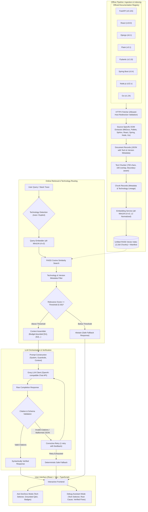

# DevDocs RAG — Multi-Technology Documentation & Debugging Assistant

DevDocs RAG is a full-stack, production-grade technical documentation and debugging assistant. It retrieves semantically relevant passages from curated official developer documentation across **eight major technical frameworks**, generates grounded answers and structured error diagnoses with verified citations, and provides strict abstention and anti-hallucination safeguards.

---

## 1. Supported Technology Registry

DevDocs RAG features an official, configurable documentation registry supporting eight core technologies with deterministic extraction strategies and version labels:

| Technology | Tech ID | Display Name | Version | Official Root URL | Extracted Pages | Indexed Chunks |
| :--- | :--- | :--- | :--- | :--- | :---: | :---: |
| **FastAPI** | `fastapi` | FastAPI | 0.115 | https://fastapi.tiangolo.com/ | 5 | 98 |
| **React** | `react` | React | 19.0 | https://react.dev/ | 5 | 180 |
| **Django** | `django` | Django | 6.1 | https://docs.djangoproject.com/en/stable/ | 5 | 213 |
| **Flask** | `flask` | Flask | 3.1 | https://flask.palletsprojects.com/ | 4 | 110 |
| **Pydantic** | `pydantic` | Pydantic | 2.10 | https://docs.pydantic.dev/latest/ | 4 | 153 |
| **Spring Boot** | `spring-boot` | Spring Boot | 3.4 | https://docs.spring.io/spring-boot/index.html | 6 | 237 |
| **Node.js** | `nodejs` | Node.js | 22.x | https://nodejs.org/docs/latest/api/ | 6 | 1,111 |
| **Go** | `go` | Go (Golang) | 1.24 | https://go.dev/doc/ | 4 | 214 |
| **Total Corpus** | — | — | — | — | **39** | **2,316** |

---

## 2. System Architecture

The following diagram illustrates the complete end-to-end architecture, from multi-technology documentation ingestion and indexing to online retrieval, technology auto-detection, Groq LLM generation, citation validation, and user interaction.



---

## 3. Technology Stack

### Backend
- **Framework:** FastAPI (Python 3.12+) with Uvicorn ASGI server
- **LLM Provider:** Groq SDK (`groq`) using `openai/gpt-oss-120b` or `llama-3.3-70b-versatile`
- **Embeddings:** `sentence-transformers/all-MiniLM-L6-v2` (384 dimensions)
- **Vector Index:** FAISS (`IndexFlatIP`, CPU-optimized exact inner-product with 2,316 indexed vectors)
- **Data Validation:** Pydantic v2 & Pydantic-Settings
- **HTML Extraction:** BeautifulSoup 4 with source-tailored extraction strategies (`nodejs_api`, `spring_docs`, `django_sphinx`, `flask_pallets`, `fastapi_mkdocs`, `react_dev`, `go_pkg`)
- **Testing:** Pytest (169 unit and regression tests, 100% passing)

### Frontend
- **Framework:** React 18 with TypeScript
- **Build Tool:** Vite
- **Components:** Technology selector dropdowns (Auto-detect + 8 technologies), Grounded Source Cards, Citation pills, Ecosystem badges
- **Linter:** Oxlint (0 warnings, 0 errors)

### Infrastructure & Deployment
- **Containerization:** Docker & Docker Compose
- **Web Server:** Nginx (Alpine) acting as static host and reverse proxy (`/api/` -> FastAPI)
- **Health Checks:** Native Docker Compose healthcheck probes on `/api/v1/health/`

---

## 4. API Endpoints

### 1. Documentation Registry
```http
GET /api/v1/registry/
```
**Response (200 OK):**
```json
[
  {
    "tech_id": "fastapi",
    "display_name": "FastAPI",
    "root_url": "https://fastapi.tiangolo.com/",
    "version": "0.115",
    "enabled": true
  },
  {
    "tech_id": "react",
    "display_name": "React",
    "root_url": "https://react.dev/",
    "version": "19.0",
    "enabled": true
  },
  {
    "tech_id": "spring-boot",
    "display_name": "Spring Boot",
    "root_url": "https://docs.spring.io/spring-boot/index.html",
    "version": "3.4",
    "enabled": true
  }
]
```

### 2. Semantic Retrieval (Top-K Search with Technology Filtering)
```http
POST /api/v1/retrieve/
Content-Type: application/json
```
**Request Body:**
```json
{
  "query": "How do I configure Spring Boot profiles?",
  "technology": "spring-boot",
  "top_k": 3,
  "min_score": 0.30
}
```
**Response (200 OK):**
```json
{
  "query": "How do I configure Spring Boot profiles?",
  "total_results": 3,
  "detected_technology": "spring-boot",
  "results": [
    {
      "chunk_id": "e17704978949b4a663134ff87967481b1f7cb5f474a4262c035944fae02e75bf_0",
      "text": "Spring Profiles provide a way to segregate parts of your application configuration...",
      "source_url": "https://docs.spring.io/spring-boot/reference/features/profiles.html",
      "document_id": "e17704978949b4a663134ff87967481b1f7cb5f474a4262c035944fae02e75bf",
      "section_title": "Adding Active Profiles",
      "score": 0.732,
      "technology": "spring-boot",
      "doc_version": "3.4"
    }
  ]
}
```

### 3. Grounded Question Answering (RAG)
```http
POST /api/v1/ask/
Content-Type: application/json
```
**Request Body:**
```json
{
  "query": "How do I declare state in React using useState?",
  "technology": "react",
  "top_k": 5
}
```
**Response (200 OK):**
```json
{
  "query": "How do I declare state in React using useState?",
  "answer": "To declare a state variable in React, call the `useState` Hook at the top level of your component [S1]. It returns an array with the current state value and a setter function [S1].",
  "sources": [
    {
      "source_id": "S1",
      "chunk_id": "chunk_react_usestate_0",
      "document_id": "doc_react_usestate",
      "section_title": "useState",
      "source_url": "https://react.dev/reference/react/useState",
      "score": 0.742,
      "technology": "react",
      "doc_version": "19.0"
    }
  ],
  "total_sources": 1,
  "model": "openai/gpt-oss-120b",
  "detected_technology": "react"
}
```

### 4. Documentation-Grounded Debugging Assistant
```http
POST /api/v1/debug/
Content-Type: application/json
```
**Request Body:**
```json
{
  "error_message": "org.springframework.beans.factory.NoSuchBeanDefinitionException: No qualifying bean of type 'UserService'",
  "technology": "spring-boot",
  "language": "Java",
  "context": "Calling controller endpoint with injected UserService"
}
```
**Response (200 OK):**
```json
{
  "error_summary": "NoSuchBeanDefinitionException indicates that Spring Boot's ApplicationContext could not locate a registered bean definition for 'UserService'.",
  "likely_causes": [
    {
      "cause": "Missing component scanning annotation",
      "explanation": "Spring cannot instantiate or inject beans unless the class is annotated with @Service, @Component, or defined in a @Configuration class [S1].",
      "citations": ["S1"]
    }
  ],
  "diagnostic_checks": [
    "Verify that UserService is annotated with @Service or @Component",
    "Check that UserService is located inside the base package scanned by @SpringBootApplication"
  ],
  "suggested_fixes": [
    {
      "fix": "Annotate UserService with @Service",
      "explanation": "Add @Service above the UserService class definition so component scanning detects it [S1].",
      "citations": ["S1"]
    }
  ],
  "sources": [
    {
      "source_id": "S1",
      "chunk_id": "da4663c0b2f73703f97309a13e49a0cecc790146e879cca04e1794b8c32de350_0",
      "document_id": "da4663c0b2f73703f97309a13e49a0cecc790146e879cca04e1794b8c32de350",
      "section_title": "Spring Beans and Dependency Injection",
      "source_url": "https://docs.spring.io/spring-boot/reference/using/spring-beans-and-dependency-injection.html",
      "score": 0.718,
      "technology": "spring-boot",
      "doc_version": "3.4"
    }
  ],
  "total_sources": 1,
  "uncertainty_notes": [],
  "model": "openai/gpt-oss-120b",
  "detected_technology": "spring-boot"
}
```

---

## 5. Retrieval Benchmark Evaluation

The evaluation benchmark evaluated 44 diverse queries across all 8 indexed technologies and out-of-domain categories using the unified 2,316-chunk FAISS index with `all-MiniLM-L6-v2`:

### Overall Metrics
- **Evaluated Queries:** 44 total (40 in-domain, 4 out-of-domain)
- **Recall@1:** **85.00%** (34/40)
- **Recall@3:** **97.50%** (39/40)
- **Recall@5:** **100.00%** (40/40)
- **Mean Reciprocal Rank (MRR):** **0.9146**
- **Abstention Rate (Out-of-Domain):** **50.00%** (strict similarity cutoff filtering at `min_score = 0.30`)
- **End-to-End Retrieval Latency (p50):** **14.80 ms**
- **End-to-End Retrieval Latency (p95):** **17.16 ms**
- **Embedding Latency (p50):** **15.66 ms**
- **FAISS Search Latency (p50):** **0.28 ms**

### Per-Technology Retrieval Breakdown
| Technology | Queries (N) | Recall@1 | Recall@3 | Recall@5 | MRR |
| :--- | :---: | :---: | :---: | :---: | :---: |
| **Django** | 4 | 100.0% | 100.0% | 100.0% | 1.0000 |
| **Flask** | 4 | 100.0% | 100.0% | 100.0% | 1.0000 |
| **Go (Golang)** | 4 | 100.0% | 100.0% | 100.0% | 1.0000 |
| **Pydantic** | 4 | 100.0% | 100.0% | 100.0% | 1.0000 |
| **React** | 4 | 100.0% | 100.0% | 100.0% | 1.0000 |
| **Spring Boot** | 4 | 100.0% | 100.0% | 100.0% | 1.0000 |
| **Node.js** | 4 | 75.0% | 100.0% | 100.0% | 0.8750 |
| **FastAPI** | 12 | 58.3% | 91.7% | 100.0% | 0.7569 |

---

## 6. Setup & Running Instructions

### Option 1: Running with Docker Compose (Recommended)

1. **Configure Environment:**
   ```bash
   cp .env.example .env
   ```
   Provide your Groq API key:
   ```env
   GROQ_API_KEY=gsk_your_actual_groq_api_key_here
   ```

2. **Start Services:**
   ```bash
   docker compose up -d --build
   ```

3. **Access Services:**
   - **Frontend UI:** [http://localhost:3000](http://localhost:3000)
   - **Backend API Docs:** [http://localhost:8000/docs](http://localhost:8000/docs)
   - **Health Endpoint:** [http://localhost:8000/api/v1/health/](http://localhost:8000/api/v1/health/)
   - **Registry Endpoint:** [http://localhost:8000/api/v1/registry/](http://localhost:8000/api/v1/registry/)

4. **Stop Services:**
   ```bash
   docker compose down
   ```

---

### Option 2: Running Locally (Windows PowerShell)

#### Backend Setup
```powershell
# 1. Activate Python virtual environment
.\.venv\Scripts\Activate.ps1

# 2. Install dependencies
pip install -r backend\requirements.txt

# 3. Configure environment
$env:GROQ_API_KEY="gsk_your_groq_api_key"

# 4. Ingest and build multi-technology index (if rebuilding)
python -m app.ingestion.pipeline
python -m app.chunking.pipeline
python -m app.vector_store.pipeline

# 5. Start FastAPI server
cd backend
uvicorn app.main:app --reload --port 8000
```

#### Frontend Setup
```powershell
cd frontend
npm install
npm run dev
```

---

## 7. Verification & Test Execution

### Running Backend Unit & Regression Tests (169 Tests)
```powershell
cd backend
python -m pytest tests/ -v
```
*All 169 tests pass with 100% success rate across registry, ingestion, extraction, chunking, vector index, semantic retrieval, RAG generation, debugging assistant, and backward compatibility.*

### Running Multi-Technology Retrieval Benchmark Evaluation
```powershell
cd backend
python scripts/evaluate_retrieval.py
```
*Results are written to `backend/data/eval/retrieval_eval_results.json`.*

### Building and Linting Frontend
```powershell
cd frontend
npm run lint    # Oxlint check (0 errors, 0 warnings)
npm run build   # TypeScript compilation & Vite bundle
```

---

## 8. Release Readiness Assessment

| Verification Area | Status | Evidence |
| :--- | :--- | :--- |
| **Backend Test Suite** | Passed | 169 / 169 tests passing in pytest |
| **Official Tech Registry** | Verified | 8 technologies configured with approved hosts, versions & strategies |
| **Vector Store Index** | Built | 2,316 chunks indexed in unified FAISS store without corruption |
| **Frontend TypeScript** | Passed | `tsc -b` compiled cleanly |
| **Frontend Linter** | Passed | Oxlint verified with 0 errors, 0 warnings |
| **Retrieval Recall@5** | Passed | 100.00% across all in-domain multi-technology benchmark queries |
| **Retrieval MRR** | Passed | 0.9146 mean reciprocal rank |
| **Docker Compose** | Healthy | Both `devdocs-backend` and `devdocs-frontend` running and passing healthchecks |
| **Security & Secrets** | Verified | No API keys committed; clean `.env.example` template; diagnostic secrets redacted |
